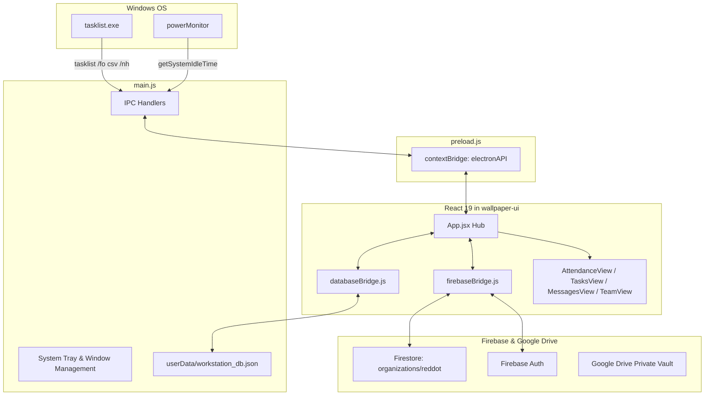

# REDDOT Workstation — Current Architecture Audit

**Status**: Verified Snapshot (Phase 1 Reconnaissance)  
**Date**: November 2026  
**Application**: REDDOT Workstation OS  

---

## 1. Executive Summary & Tech Stack Overview

The REDDOT Workstation is an enterprise desktop employee collaboration and presence monitoring platform. It combines wallpaper-mode pinning with desktop operations:

- **Desktop Host**: Electron 34.0.0 (Node.js runtime, native Windows integration).
- **Frontend Presentation**: React 19.0.0 bundled with Vite 6.2.0.
- **Packaged Output**: `wallpaper-ui/` directory containing static HTML, CSS, bundled JS chunks, and Firebase compat SDK wrappers.
- **Cloud Backend**: 
  - Firebase Authentication (Google OAuth + Email/Password).
  - Cloud Firestore (`organizations/reddot/` root tenancy).
  - Firebase Realtime Database (RTDB presence placeholder).
- **Local Persistence**: Electron IPC saving state JSON (`workstation_db.json` in user data) via `databaseBridge.js`.
- **Ancillary Microservice**: Node.js/Express attachment service (`backend/server.js`) on port 5050 with Google Drive API v3 bridge.
- **Native OS Hooks**: Windows `tasklist.exe` scanning for work applications, `powerMonitor` for system idle time detection.

---

## 2. Technology Stack Breakdown

| Component | Technology | Version | Purpose |
|---|---|---|---|
| Runtime | Electron | 34.0.0 | Native windowing, tray, tasklist execution, power monitoring |
| Frontend Library | React | 19.0.0 | Reactive UI components |
| Build Tool | Vite | 6.2.0 | Fast HMR and bundle compilation to `wallpaper-ui/` |
| Styling | Tailwind CSS v4 + Vanilla CSS | 4.0.9 | High-fidelity dark/light workspace theme and flip clock tiles |
| Cloud Database | Google Cloud Firestore | Compat v10.7.1 | Team data, messages, task cards, punch logs |
| Auth Provider | Firebase Authentication | Compat v10.7.1 | Identity verification with strict `@reddot` / approved whitelist |
| Local Storage | Custom JSON Bridge | Node fs via IPC | Local offline caching of workspace state |
| Voice/Video Calls | Jitsi Meet signaling | Firebase doc sync | P2P audio/video communication via room tokens |

---

## 3. Process Architecture & Data Flow

---

## 4. Architectural Bottlenecks & Critical Flaws Identified

### 4.1. Runaway Firebase Read Loops (Exhausting Free Tier)
- **Direct Unbounded Listeners**: `onSnapshot` queries in `firebaseBridge.js` and `wallpaper-ui/firebase-service.js` lacked date filters on `punchLogs` and `messages`. Every update re-read entire collections across all connected clients.
- **Double Bridge Initialization**: Both `firebaseBridge.js` in React and the legacy `firebase-service.js` loaded via script tags created parallel snapshot connections to identical Firestore documents.
- **Missing IndexedDB Offline Persistence**: The Web SDK was not initialized with `enableIndexedDbPersistence()`, forcing every app reload to fetch full snapshots from the cloud instead of reading local disk cache.

### 4.2. Local vs. Cloud Attendance Desynchronization
- Punches recorded via `handleRecordAttendance` in `App.jsx` wrote locally to `databaseBridge.appendPunchLog`, but cold restarts restored state prior to verifying the local JSON file against pending unsynced records.
- Productive time was computed via an in-memory timer rather than subtracting real system idle time (`powerMonitor.getSystemIdleTime()`), causing discrepancies when employees stepped away from their desks.

### 4.3. Orphaned Taskbar App Monitoring
- `main.js` correctly implements `get-running-work-apps` using `tasklist /fo csv /nh` and caches detected engineering tools (VS Code, Chrome, Teams, Terminal, Notion, etc.).
- However, `App.jsx` maintained `runningApps: []` in state without an active polling interval calling `electronBridge.getRunningWorkApps()`, leaving the live taskbar indicators empty.

### 4.4. Security Weaknesses
- **Terminal Execution**: `child_process.exec` in `main.js` executed arbitrary command strings sent over IPC without parameter validation or path whitelisting.
- **Unrestricted Local Express Server**: The attachment service on port 5050 accepted unauthenticated requests on `localhost`, assuming only the desktop app could communicate with it.

---

## 5. Technology Debt & Redundancies

1. **Vite Output Debris**: `wallpaper-ui/assets/` accumulated hundreds of megabytes of old compilation hashes that must be pruned during the build pipeline.
2. **Hardcoded Fallback Credentials**: Hardcoded email strings (`jagadish2k2006@gmail.com`) functioned as fallbacks in `MessagesView.jsx` instead of cleanly extracting identity from `firebaseBridge.activeUser`.
3. **No Central Background Coordinator**: File uploads, attendance synchronization, and message fetching all had independent, uncoordinated retry loops.

