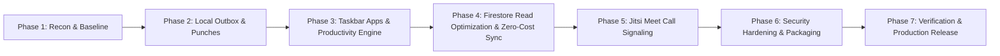

# REDDOT Workstation — Master Engineering Migration Plan

**Strategy**: Safe, incremental, zero-downtime execution with 100% UI/UX preservation.

---

## Phase Breakdown & Execution Sequence

---

### Step 1: Baseline Checkpoint (Completed)
- Capture git diffs, ensure no destructive data wipes.
- Establish clean documentation directory in `docs/`.

### Step 2: Local-First Attendance & Punch Outbox
- **Files to Modify**: `react-app/src/services/databaseBridge.js`, `react-app/src/App.jsx`, `react-app/src/components/AttendanceView.jsx`.
- **Implementation**:
  - Guarantee local JSON append occurs synchronously before cloud dispatch.
  - Implement `sync_outbox` queue: whenever network is offline or Firebase hits quota, save punch with `cloudSynced: false` and replay on connection restoration.
  - Restore shift state on boot by reading the local disk punch logs, preventing lost attendance data.

### Step 3: Realtime Taskbar App Monitoring & Productivity Calculation
- **Files to Modify**: `react-app/src/App.jsx`, `react-app/src/components/TeamView.jsx`, `react-app/src/components/AttendanceView.jsx`.
- **Implementation**:
  - Add a 30s polling cycle in `App.jsx` calling `electronBridge.getRunningWorkApps()`.
  - Store detected tools (`VS Code`, `Chrome`, `Teams`, `Word`, `Excel`, etc.) into state and sync to user's presence document in Firestore every 60s.
  - Calculate active productive time by reading `powerMonitor.getSystemIdleTime()`: if idle time exceeds 5 minutes, pause productive hour counter and tag state as `AWAY / IDLE`.

### Step 4: Firestore Read Optimization & Zero-Cost Infrastructure
- **Files to Modify**: `react-app/src/services/firebaseBridge.js`, `wallpaper-ui/firebase-config.js`.
- **Implementation**:
  - Enable Firestore offline cache persistence: `firebase.firestore().enablePersistence({ synchronizeTabs: true })`.
  - Limit message listeners strictly to the current active channel with `limit(50)`.
  - Scrape duplicate listener in `wallpaper-ui/firebase-service.js` and unify all Firestore calls through `firebaseBridge.js`.
  - Add date bounds (`where('timestamp', '>=', startOfMonth)`) to punch log queries to eliminate reading years of historical logs on startup.

### Step 5: Native In-App Calling (Jitsi Meet Integration)
- **Files to Modify**: `react-app/src/components/TeamView.jsx`, `react-app/src/services/firebaseBridge.js`.
- **Implementation**:
  - Replace the static timer mock in `TeamView.jsx` call modal with a responsive Jitsi Meet IFrame (`https://meet.jit.si/reddot_room_...`) when a call connects.
  - Wire `sendCallInvite` and incoming call notifications so employees receive instant ring notifications across different networks.

### Step 6: Security Hardening, Clean Build & Verification
- **Files to Modify**: `main.js`, `preload.js`, `package.json`.
- **Implementation**:
  - Whitelist commands in `terminal-exec`.
  - Purge stale assets from `wallpaper-ui/assets/`.
  - Rebuild UI (`npm run build:ui`) and run automated test suite (`npm test`).
  - Verify complete application packaging with Electron.

